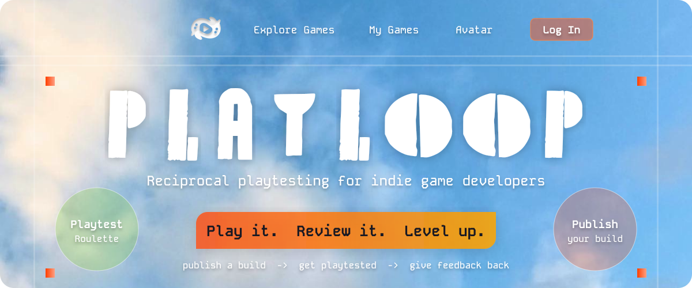
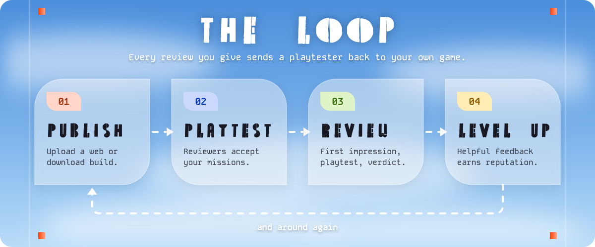
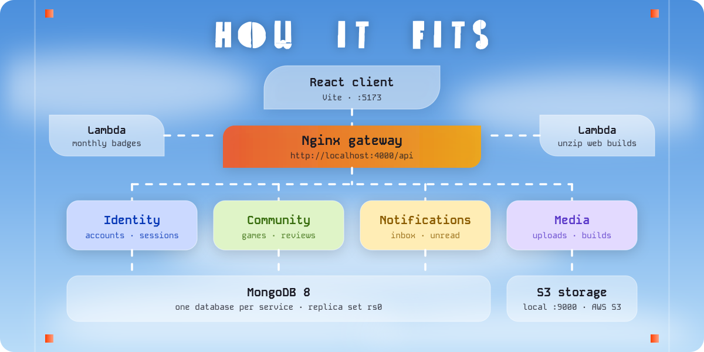

<div align="center">




**[The loop](#the-loop)** · **[How it fits](#how-it-fits)** · **[Start here](#start)** · **[Run](#run)** · **[Seed](#seed)** · **[Frontend](#frontend)** · **[API docs](#docs)** · **[API rules](#api)** · **[Deploy](#deploy)**

</div>

# PlayLoop

Reciprocal playtesting platform for indie game developers.

Publish a build, get it playtested by other developers, and pay it back by reviewing theirs. Reviews follow a three-step form (First Impression, Playtest, Final Verdict), and helpful feedback earns reputation, levels and badges.

<a name="the-loop"></a>



<a name="how-it-fits"></a>



The API is four Node services behind an Nginx gateway: Identity, Community, Notifications and Media. Each service has its own MongoDB database, and everything runs in Docker. The React client in `client/` runs separately with Vite.

| Where       | What lives there                                        |
| ----------- | ------------------------------------------------------- |
| `client/`   | React + Vite app ([client/README.md](client/README.md)) |
| `services/` | Gateway, the four services and the stack tests          |
| `lambdas/`  | Monthly badges and web-build unzip                      |
| `shared/`   | Code shared by the client and the services              |
| `docs/api/` | The OpenAPI contract                                    |
| `infra/`    | AWS deployment ([infra/README.md](infra/README.md))     |

<a name="start"></a>


You need:

- Node.js 22 or newer (`nvm use` reads `.nvmrc`)
- Docker Desktop, running

<a name="run"></a>


From the repo root:

```sh
npm install
npm run dev
```

`dev` builds the images and starts the gateway on port 4000, the four services, MongoDB on port 27017 (replica set `rs0`) and local S3-compatible storage on port 9000. The service ports stay private to the Compose network. Compose reads secrets from an optional `.env` in the repo root. Every value has a local default, and `.env.example` lists them.

| URL                                         | What it is                                                 |
| ------------------------------------------- | ---------------------------------------------------------- |
| http://localhost:4000                       | API                                                        |
| http://localhost:4000/api/docs              | Swagger UI                                                 |
| http://localhost:4000/api/docs/openapi.json | OpenAPI document                                           |
| http://localhost:4000/api/health            | `{ "status": "ok", "db": "connected" }` when MongoDB is up |

Stop the stack with <kbd>Ctrl</kbd> + <kbd>C</kbd>, then remove the containers with:

```sh
npm run services:down
```

Run the tests with `npm test`. They start all four services in one process, and the services call each other over real HTTP.

With the stack running and seeded, `SEED_PASSWORD=<password> npm run smoke` runs one full journey through the gateway, using the password from the seed.

> [!NOTE]
> MongoDB 8 does not start on Linux hosts with kernel 6.19 or newer. Set `MONGO_VERSION=7.0` in the root `.env` there.

<a name="seed"></a>


With the stack running, from the repo root:

```sh
npm run seed
```

This seeds Identity first, then Community. It inserts four demo accounts, two published sample game listings and default app configuration if missing. It keeps existing records, passwords and edits, so rerunning does not duplicate anything. Demo seeding is disabled for `NODE_ENV=production`.

| Account                      | Role  |
| ---------------------------- | ----- |
| `developer@seed.example.com` | user  |
| `creator@seed.example.com`   | user  |
| `tester@seed.example.com`    | user  |
| `admin@seed.example.com`     | admin |

A random password is printed for newly created accounts. To choose it, set `SEED_PASSWORD` in the root `.env` (at least 12 characters, at most 72 bytes) before the first run. Rerunning does not reset passwords.

Games contain placeholder URLs (`https://example.com`) and no uploaded images or playable builds. Reviews are not seeded.

> [!WARNING]
> Do not commit `.env` or demo passwords.

<a name="frontend"></a>


The React + Vite client lives in [`client/`](client/README.md). Start the API with `npm run dev` first, then run the client:

```sh
npm run dev:client
```

It opens on http://localhost:5173, and `/api` is proxied to the gateway on port 4000.

| Script                 | What it does              |
| ---------------------- | ------------------------- |
| `npm run dev:client`   | Start the Vite dev server |
| `npm run test:client`  | Run the client tests      |
| `npm run lint:client`  | Lint the client           |
| `npm run build:client` | Build for production      |

<a name="docs"></a>


Start the API with `npm run dev`, then open http://localhost:4000/api/docs in a browser. That page is Swagger UI: each endpoint can be expanded and tried from there.

The same document as JSON is at http://localhost:4000/api/docs/openapi.json. The source file is `docs/api/openapi.yaml`.

These pages are served only when `NODE_ENV` is not `production`. Compose sets `development`.

<a name="api"></a>


The contract is `docs/api/openapi.yaml`. Request and response bodies are checked against it outside production. Check the spec with `npm run spec:lint`.

- Base path is `/api`. Paths in the docs are relative to that, so `POST /auth/login` is `POST http://localhost:4000/api/auth/login`.
- `POST /api/auth/register` and `POST /api/auth/login` set an httpOnly cookie named `playloop_token` (7 days). Send later requests with credentials. Swagger UI keeps that cookie in the browser. From another client, store the cookie and send it back.
- Login accepts an email or a username in the `email` field. A wrong email, username, or password returns `401`. A banned or suspended account returns `403`.
- Logged-out calls to protected routes return `401`. Doing someone else's action returns `403`.
- Errors are `{ "code", "message", "details?" }`. `details` is only present for `VALIDATION_ERROR`.
- Lists take `page` (from 1) and `limit` (max 50) and return `{ "items", "page", "limit", "total" }`.
- Uploads go to storage, not through the API body: `POST /api/uploads`, PUT the file to the returned URL, then `POST /api/uploads/{uploadId}/complete`.
- Rate limits return `429` with code `RATE_LIMITED`.
- Payments are not in this version.

<details>
<summary><b>Try it with curl</b></summary>

<br>

In PowerShell, call `curl.exe` so the commands below are not handled by `Invoke-WebRequest`.

```sh
curl.exe http://localhost:4000/api/health
curl.exe -c cookies.txt -H "Content-Type: application/json" -d "{\"username\":\"ada\",\"email\":\"ada@example.com\",\"password\":\"password123\",\"acceptTerms\":true}" http://localhost:4000/api/auth/register
curl.exe -b cookies.txt http://localhost:4000/api/me
```

</details>

<a name="deploy"></a>


See [infra/README.md](infra/README.md) for the EC2 deployment (Docker Compose, Atlas, S3/CloudFront, Lambda, CloudWatch and Amplify). Use the standalone `docker-compose.ec2.yml` for AWS; `docker-compose.yml` remains the local development stack.

<br>

<div align="center">


</div>
